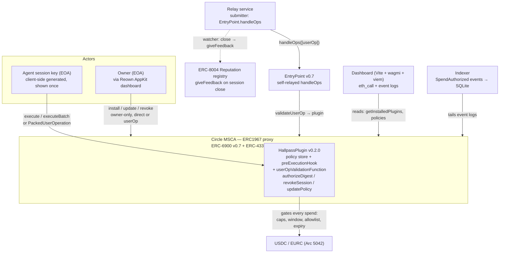

# HALLPASS

> **Give your agent a hall pass — not your keys.**

[](https://explorer.arc.io)
[](https://eips.ethereum.org/EIPS/eip-6900)
[](https://eips.ethereum.org/EIPS/eip-4337)
[](LICENSE)

Installable **ERC-6900 v0.7 policy plugins** for Circle's modular smart accounts (MSCAs) on **Arc mainnet (chain 5042)**. HALLPASS gives an agent's hot key — a *session key* — bounded spending authority enforced **on-chain by the account itself**: per-transaction cap, rolling-window cap, recipient allowlist, expiry, instant revocation. Every violation **reverts on-chain** — the money never moves.

**No demo mode. No mock data. No fake success.** Every UI action that looks executable submits a real transaction or userOp on Arc mainnet, or is disabled with the exact reason displayed. Every state shown comes from chain. The proof ledger ([PROOFS.md](PROOFS.md)) lists full tx hashes for every claim — PROVEN means *executed on mainnet*, SPECIFIED means *designed, not yet live*. Nothing in between.

**Fastest way to trust this:** open the contract registry below, click any explorer link, read the tx status and revert reasons yourself.

---

## The story

**The metaphor.** A school hall pass: *"You may leave the room — but only to the bathroom, and only until the bell rings."* Permission with built-in expiry and destination bounds. *"Show me your hall pass"* is how the account says no. Every visual, every headline, every line of copy in this product should feel like a permission slip glowing with allowed bounds — **amber light = allowed**.

**The problem.** AI agents need to spend money on-chain — paying for APIs, tools, data, compute. Today a team faces a brutal choice: hand the agent your private key (all-or-nothing access; the agent can drain everything — reckless) or keep the agent on a leash so short it's useless (manual approvals for every 1-cent API call — the agent might as well not exist). Keys are binary: you either trust completely, or you don't use agents at all. Off-chain spend trackers don't fix this — their refusal lives in a server, not at the money's location.

**The solution.** HALLPASS installs a policy plugin on your Circle smart account. The operator installs it once (one owner-signed action); from then on, every spend the session key attempts is gated by the plugin at the account's execution layer. Spends inside the bounds succeed normally; the moment the agent tries to exceed one, the transaction **reverts on-chain** with a clear, human-readable reason (`PerTxCapExceeded(0.50, 0.10)` — not a hex blob). Revocation is one transaction: the key dies instantly, and unspent funds never left the account. Typed-data authorizations (the kind x402 payment facilitators use) are covered too — pre-authorized per-digest through the account, verified on-chain via `isValidSignature`. See the [typed-data routing caveat](#typed-data-routing--what-facilitators-cant-reach) — mechanism proven, account-routing proven impossible.

---

## Architecture

Four pieces. No token, no factory, no fees, no admin.



The diagram above renders on GitHub (Mermaid). The ground-truth ASCII version is kept below — same system, same labels:

```
┌──────────────┐      userOp / tx       ┌─────────────────────────────┐
│  Owner (EOA) │ ─────────────────────▶ │  Circle MSCA (ERC1967 proxy) │
│  via Reown   │   install/update/      │  impl 0xA70F1296869DA9D7CB69578123F21888E6dB2B62
│  dashboard   │   revoke (owner-only)  │                             │
└──────────────┘                        │  ┌───────────────────────┐  │
                                        │  │ HallpassPlugin        │  │
┌──────────────┐      userOp            │  │ (ERC-6900 v0.7)       │  │
│ Session key  │ ─────────────────────▶ │  │ - policy store        │◀─┼── gates every spend
│ (agent hot   │   execute/executeBatch │  │ - preExecutionHook    │  │
│  key, EOA)   │   authorizeDigest      │  │ - userOp validation   │  │
└──────────────┘                        │  │ - isValidSignature    │◀─┼── typed-data path
                                        │  │   (SigGate pattern)   │  │
┌──────────────┐      eth_call /        │  └───────────────────────┘  │
│  Dashboard   │   event logs           │  EntryPoint v0.7            │
│  (Vite)      │ ◀────────────────────  │  0x0000…032 (self-relayed)  │
└──────────────┘                        └─────────────────────────────┘
        │                                    ▲
        │  builds + submits                  │ handleOps (self-relay;
        ▼  PackedUserOperation                │ no public v0.7 bundler
┌──────────────┐                             │ on Arc — proven)
│ Relay service│ ────────────────────────────┘
│ (backend)    │  handleOps([userOp], beneficiary)
└──────────────┘
        │
        ▼
┌──────────────┐
│ Indexer      │  SpendAuthorized / denial events → activity feed,
│ (event logs) │  policy-hash commitments, per-session rollups
└──────────────┘
```

**Spend path, end to end:**
1. The agent's session key builds an intent (e.g., pay 0.05 USDC to an API), wrapped as an ERC-4337 v0.7 `PackedUserOperation` or a direct `execute` call.
2. The EntryPoint (userOp path) or the account's runtime validation (direct path) invokes the plugin's validation: caller must be the registered session key (owner always bypasses); `value ≤ perTxCap`; `windowSpent + value ≤ windowCap` (window resets every `windowSecs`); `to` ∈ allowlist (empty allowlist = open, caps-only mode); `block.timestamp < expiry`. Check **and** window-spend recording happen atomically in the same hook invocation (TOCTOU-proof). The counted amount is fee-inclusive.
3. Any violation → revert at the account (`PerTxCapExceeded`, `WindowCapExceeded`, `NotAllowlisted`, `SessionExpired`, `SessionRevoked` — all decodable custom errors). Success → `SpendAuthorized(session, to, amount, policyHash, windowUsed)` event.
4. **Typed-data path:** the session key pre-authorizes `(digest → to/value/expiry)` *through the account* (`authorizeDigest`, policy-gated); signs EIP-3009 typed data off-chain; the plugin's `isValidSignature` returns MAGIC `0x1626ba7e` iff (digest pre-authorized) ∧ (`ecrecover == sessionKey`) ∧ (unexpired). Unauthorized or over-cap digests return `0xffffffff` or revert. **Routing caveat:** calling the plugin with `msg.sender == account` (the only shape that can reach the policy) works and is proven; calling through the account's own `isValidSignature` dispatch reverts — the MSCA handles selector `0x1626ba7e` natively and never falls through to the plugin. Full evidence: [PROOFS-SIG-ADDENDUM.md](PROOFS-SIG-ADDENDUM.md).

### The core lifecycle, exactly as proven on mainnet

```mermaid
sequenceDiagram
    participant Owner as Owner (EOA)
    participant Account as MSCA (ERC1967 proxy)
    participant Plugin as HallpassPlugin v0.2.0
    participant EP as EntryPoint v0.7
    participant Tokens as USDC / EURC

    Owner->>Account: installPlugin(...) — one owner-signed action
    Account->>Plugin: onInstall(policy: caps, allowlist, expiry, sessionKey)
    Plugin-->>Account: policy stored, hooks registered
    Note over Account,Plugin: Session live — bounded authority begins

    Owner-->>Agent: session private key handed off-band<br/>(shown once, never stored server-side)

    rect rgb(12, 30, 18)
    Note over Agent,EP: IN-POLICY — funds move, event emitted
    Agent->>EP: userOp: executeBatch([payee], [0.002], [calldata])<br/>session-key ECDSA, self-relayed handleOps
    EP->>Plugin: validateUserOp — caller == sessionKey?
    Plugin->>Plugin: value ≤ perTxCap? windowSpent+value ≤ windowCap?<br/>to ∈ allowlist? now before expiry?
    Plugin-->>EP: VALID (check + window-record atomic)
    EP->>Account: executeBatch — funds move
    Account->>Tokens: transfer(payee, 0.002)
    Plugin-->>Account: SpendAuthorized(session, to, 0.002, policyHash, windowUsed)
    end
    Note over EP: tx 0x9b74befe…ee230f7 — status 1 (PROVEN)

    rect rgb(38, 16, 12)
    Note over Agent,EP: OVER-CAP — revert at validation, money never moves
    Agent->>EP: userOp: executeBatch([payee], [0.05], [calldata])
    EP->>Plugin: validateUserOp
    Plugin->>Plugin: 0.05 > perTxCap 0.01 → REVERT
    Plugin-->>EP: FailedOpWithRevert(0, "AA23 reverted", PerTxCapExceeded)
    end
    Note over EP: tx 0x6c74adf1…5f430d3 — status 0 (PROVEN)<br/>window accounting untouched by the revert

    Owner->>Account: revokeSession() — one tx
    Account->>Plugin: revoked = true — the key dies instantly
    Agent->>EP: userOp: execute(...)
    EP->>Plugin: validateUserOp
    Plugin-->>EP: revert SessionRevoked()
    Note over EP: post-revoke spend reverts — no funds, no allowance, nothing
```



**Two deployment shapes, both proven:**
- **Hallpass-first account** — plugin installed at account creation via `initializeUpgradableMSCA`. Full plugin owns userOp + runtime validation. Best for new deployments.
- **Existing accounts** (e.g., multisig-owned) — hooks-only minimal plugin installed post-creation via owner-signed **userOp** through the EntryPoint (`installPlugin` selector `f85730f4`). The minimal plugin's manifest claims no validation slots (hook lists compose, validation slots are exclusive — proven by a live revert).

**Factory note (load-bearing):** Circle's `UpgradableMSCAFactory.createAccount` is **allowlisted** for init plugins. Do NOT use the factory path. Deploy a minimal ERC1967 proxy directly against Circle's live implementation `0xA70F1296869DA9D7CB69578123F21888E6dB2B62` and call `initializeUpgradableMSCA` — the identical `PluginManager.install` code path, minus the allowlist gate. Proven on mainnet.

---

## Repo layout

```
hallpass-build/
├── README.md                 ← this file (the front door)
├── PROOFS.md                 ← full mainnet test-evidence ledger (tx hashes for every claim)
├── PROOFS-SIG-ADDENDUM.md    ← isValidSignature routing verdict (proven mechanism, proven non-routable)
├── REPUTATION-PROOF.md       ← ERC-8004 giveFeedback dust proof + watcher design
├── TEST-REPORT.md            ← Q3 full test-suite report (per-suite commands + counts)
├── HISTORY.md · MOCKHUNT.md · UX-AUDIT.md  ← build logs, mock-hunt discipline, UX audit
├── .env.example              ← key names + placeholders ONLY; never commit a filled .env
├── contracts/                ← Foundry project (solc 0.8.24, optimizer 200)
│   ├── src/HallpassPlugin.sol    ← full policy plugin: policy store, userOp/runtime
│   │                               validation, preExecutionHook, revoke/update,
│   │                               SigGate-style isValidSignature module
│   ├── test/HallpassPlugin.t.sol ← unit suite (malleability-bound probe included)
│   ├── test/HallpassFork.t.sol   ← fork suite vs live Arc mainnet state
│   ├── script/DeployHallpass.s.sol + VerifyHallpass.sh  ← deploy + Sourcify verify helper
│   ├── deployments/arc-5042.json ← v0.2.0 record: address, tx hash, block, exact_match
│   ├── DEPLOYMENT.md · GAS.md · AUDIT-NOTES.md
│   ├── foundry.toml              ← rpc_endpoints: arc = https://rpc.mainnet.arc.io
│   └── lib/                      ← forge-std (submodule)
├── backend/                  ← Node 20 services (no keys, no policy decisions, no invented state)
│   ├── api/                  ← dashboard API: server.js, stats.js, CONTRACT.md, OPENAPI.yaml,
│   │                           STATS.md (+ node:test contract suites)
│   ├── indexer/              ← event indexer → SQLite: SpendAuthorized, installs,
│   │                           policy updates, revokes, authorizations; per-session rollups
│   │                           (the chain is truth — the indexer is cache, rebuildable)
│   ├── reputation/           ← watcher.js: on session close → giveFeedback to ERC-8004 registry
│   ├── render.yaml           ← Render blueprint: hallpass-api, free web service
│   ├── Dockerfile / start.sh ← container entry points
│   └── README.md             ← service details + API surface
├── frontend/                 ← Reown AppKit + wagmi + viem (Arc chain built-in, 5042)
│   ├── .env.example          ← frontend env template (VITE_REOWN_PROJECT_ID etc.)
│   ├── src/
│   │   ├── App.tsx / main.tsx / index.css / vite-env.d.ts
│   │   ├── lib/: contracts.ts · wagmi.ts · userops.ts (self-relay) · useHallpass.ts
│   │   ├── components/landing/ ← landing: Metaphor, Problem, Live proof, Hero, HowItWorks, …
│   │   ├── components/app/PolicyHashPanel.tsx
│   │   ├── pages/Landing.tsx
│   │   ├── pages/app/: Connect · Accounts · SessionKeys · PolicyEditor · PoliciesScreen ·
│   │   │            Activity · Marketplace · GetEurcPanel · useDashboardStats
│   │   ├── __tests__/        ← vitest: addresses · encoding · reverts · selectors · units · userop
│   │   └── scripts/check-selectors.mjs  ← build-time selector assertion (fails build, never renders)
│   ├── vercel.json           ← Vercel deploy config
│   └── package.json          ← dev: vite · build: tsc --noEmit && vite build · test: vitest run
├── scripts/                  ← mainnet proof drivers (run against live chain, dust only):
│   │                           win-userop-proof.js/.js-f, q2-dust-e2e.js, q1-dust-e2e*.js,
│   │                           deploy-v02.js, swap-usdc-eurc.js
├── docs/VERIFICATION.md
└── QA/dust-e2e-report.md      ← build-phase dust E2E transcript
```

## Quickstart

### Prerequisites

- **Foundry** (`forge`, `cast`) — [book.getfoundry.sh](https://book.getfoundry.sh/getting-started/installation)
- **Node 20+** — check with `node -v`
- An Arc mainnet RPC: public `https://rpc.mainnet.arc.io` (or Alchemy / Blockdaemon / dRPC / QuickNode Arc endpoints)
- A wallet with a little USDC on Arc for gas (the full proof set cost ≈ 0.25 USDC; gas is 18-decimal USDC, pinned ~20 gwei)

### Install

```bash
git clone <this-repo> hallpass-build && cd hallpass-build

# contracts
cd contracts && forge install && forge build && forge test

# backend (relay + indexer + api)
cd ../backend && npm install

# frontend
cd ../frontend && npm install
```

### Environment setup

Copy the templates and fill in — **key names and placeholders only, never real values in git**:

```bash
cp .env.example .env                        # backend/relay side
cp frontend/.env.example frontend/.env      # dashboard side
```

| Variable | File | Public / SECRET | Purpose |
|---|---|---|---|
| `RPC_URL` | `.env` | Public | Arc mainnet RPC (public value, e.g. `https://rpc.mainnet.arc.io`) |
| `PLUGIN_ADDRESS` | `.env` | Public | Your HallpassPlugin deployment on Arc 5042 (from the deploy step) |
| `ENTRYPOINT_ADDRESS` | `.env` | Public | `0x0000000071727De22E5E9d8BAf0edAc6f37da032` (verified on-chain) |
| `RELAYER_PRIVATE_KEY` | `.env` | **SECRET** | Key the relay uses for `EntryPoint.handleOps` — fund with USDC for gas, **never commit, never print** |
| `REPUTATION_KEY` | `.env` | **SECRET** | Backend key that posts `giveFeedback` to the ERC-8004 registry (falls back to `DEPLOYER_PRIVATE_KEY`; never logged, never written to disk) |
| `REPUTATION_AGENT_ID` | `.env` | Public | ERC-8004 agent id for the reputation loop (a guessed id would poison the registry — never invent it) |
| `PORT` / `FRONTEND_URL` / `DB_PATH` | `.env` | Public / local | API port, dashboard origin for CORS, SQLite path |
| `VITE_REOWN_PROJECT_ID` | `frontend/.env` | Public | Reown dashboard project ID — wallet connect stays disabled until set |
| `VITE_PLUGIN_ADDRESS` | `frontend/.env` | Public | Deployed plugin — deliberately no fallback default (a missing address disables Install with a stated reason, never a silent fallback) |
| `VITE_PLUGIN_MANIFEST_HASH` | `frontend/.env` | Public | `keccak256(abi.encode(plugin.pluginManifest()))` — the app recomputes it at runtime; a mismatch is a hard error |
| `VITE_ENTRYPOINT_ADDRESS` | `frontend/.env` | Public | Canonical EntryPoint v0.7 singleton (override for disaster recovery only) |
| `VITE_API_BASE_URL` | `frontend/.env` | Public | Backend API origin; the dashboard degrades honestly when the backend is absent |
| `VITE_RPC_URL` / `VITE_RELAY_URL` | `frontend/.env` | Public | RPC override (optional); relay URL — **not implemented yet**, leave empty (dashboard self-relays via `submitUserOpDirect`) |

The dashboard renders fully with **zero** env set: wallet-gated actions disable themselves with a stated reason until configured — nothing is simulated.

### Run

```bash
# 1. contract tests — unit + fork (fork needs the live RPC)
cd contracts && forge test
forge test --fork-url https://rpc.mainnet.arc.io

# 2. backend — indexer first, then API (indexer needs no secrets: pure RPC reads)
cd ../backend
PLUGIN_ADDRESS=<deployed plugin> START_BLOCK=<deploy block> node indexer/index.js &
npm run api

# 3. frontend dashboard
cd ../frontend && npm run dev
```

Open **http://localhost:5173**. Connect a wallet → create a smart account → install the plugin → set policy → generate a session key. Everything on Arc mainnet, everything real.

---

## Testing

All acceptance runs against Arc mainnet with dust amounts. Testnet-only is not acceptance.

| Suite | Exact command | Result (verified) | Notes |
|---|---|---|---|
| Contracts — unit | `cd contracts && forge test` | **47/47 green** | incl. the malleability-bound probe (fails on pre-fix source byte-for-byte) |
| Contracts — fork | `cd contracts && forge test --fork-url https://rpc.mainnet.arc.io` | **19/19 green** | `HallpassPlugin.t.sol` + `HallpassFork.t.sol`; asserts live Arc mainnet state |
| Frontend | `cd frontend && npm test` (`vitest run`) | **76/76 green** | 6 files: addresses · encoding · reverts · selectors · units · userop — re-verified on this machine 2026-10-15 |
| Backend API | `cd backend/api && node --test *.test.js` | **32/32 green** | real in-process server + temp SQLite, against `CONTRACT.md` v1.0.0 |
| Frontend build | `cd frontend && npm run build` | **0 TS errors** | `tsc --noEmit && vite build`; `check-selectors.mjs` fails the build if any selector drifts |

**Forge total: 47 + 19 = 66.** The fork command is the supported invocation: 6 tests assert live mainnet state (EntryPoint code, W1B2 account code, installed plugin) and fail locally *by design* — see [TEST-REPORT.md](TEST-REPORT.md). Contract counts above are from [PROOFS.md](PROOFS.md) §3.5 (v0.2.0 production ledger); frontend 76/76 was re-run while writing this README.

Money-shot checklist (repeat against every production deploy; tx hashes in [PROOFS.md](PROOFS.md)):
- `installPlugin` executes (direct on hallpass-first accounts; userOp on existing accounts)
- In-policy spend succeeds; `SpendAuthorized` emits with correct fields
- Over-cap spend reverts with decodable `PerTxCapExceeded`
- Allowlist violation reverts; expired session reverts
- Real v0.7 userOp through `EntryPoint.handleOps` (self-relayed) succeeds with correct window accounting
- `revokeSession()` via the account fallback succeeds; post-revoke spend reverts `SessionRevoked()`
- `authorizeDigest` over-cap reverts; pre-authorized digest + session-key sig → MAGIC; unauthorized digest → `0xffffffff`
- `uninstallPlugin` succeeds; the account behaves as before

---

## Contract registry (Arc mainnet, chain 5042)

Every address below is copied verbatim from [PROOFS.md](PROOFS.md), [REPUTATION-PROOF.md](REPUTATION-PROOF.md), or `contracts/deployments/arc-5042.json` — never invented, never truncated. Explorer: https://explorer.arc.io · Sourcify: `https://repo.sourcify.dev/5042/<address>` — must say **exact_match**.

### HALLPASS production deployments

| Contract | Address | Deploy / proof tx | Sourcify | Purpose |
|---|---|---|---|---|
| `HallpassPlugin` **v0.2.0** (production) | [`0x5543fb530763ce21Eb827446b4913B8DB7f0D3d9`](https://explorer.arc.io/address/0x5543fb530763ce21Eb827446b4913B8DB7f0D3d9) | Deploy: [`0x2f73058a5b6bdd52df8e5a94a5db99ffd384b822f2e47ea2402d33000dcb3357`](https://explorer.arc.io/tx/0x2f73058a5b6bdd52df8e5a94a5db99ffd384b822f2e47ea2402d33000dcb3357) — block 25967278, 0.0609 USDC | [exact_match](https://repo.sourcify.dev/5042/0x5543fb530763ce21Eb827446b4913B8DB7f0D3d9) | Per-tx + rolling-window caps, allowlist, expiry, revoke/update, SigGate `isValidSignature` module, ERC-8004 reputation events |
| userOp in-policy (v0.2.0) | — | [`0x9b74befeb628ed742cd3348eb1bcd2b3f377cc71564cbf29c7912b17eee230f7`](https://explorer.arc.io/tx/0x9b74befeb628ed742cd3348eb1bcd2b3f377cc71564cbf29c7912b17eee230f7) — status **1**, block 25995761, `SpendAuthorized(spend=0.002, windowSpent=0.002)` in-validation | — | Proves the 4337 path on production (session-key ECDSA, low-s, self-relayed) |
| userOp over-cap (v0.2.0) | — | [`0x6c74adf19ec2c65d66baa9386aef9c27fc266c32b66b0cda034666ce85f430d3`](https://explorer.arc.io/tx/0x6c74adf19ec2c65d66baa9386aef9c27fc266c32b66b0cda034666ce85f430d3) — status **0**, block 25995885, `FailedOpWithRevert(0, "AA23 reverted", PerTxCapExceeded)` | — | Proves enforcement on the 4337 path; window accounting untouched |
| Throwaway MSCA (row-41 proofs) | [`0x72142EeA4217d835e34dF1728dAeB2aa9A4D7c07`](https://explorer.arc.io/address/0x72142EeA4217d835e34dF1728dAeB2aa9A4D7c07) | — | — | Account the two userOp proofs ran against |

### Chain infrastructure (RPC-verified 2026-10-14)

| Item | Address | Notes |
|---|---|---|
| Circle MSCA v1 implementation (ERC-6900 v0.7 + ERC-4337 v0.7) | [`0xA70F1296869DA9D7CB69578123F21888E6dB2B62`](https://explorer.arc.io/address/0xA70F1296869DA9D7CB69578123F21888E6dB2B62) | Deploy ERC1967 proxies against this — **not** the factory |
| Circle MSCA v1 factory | [`0x0000000DF7E6c9Dc387cAFc5eCBfa6c3a6179AdD`](https://explorer.arc.io/address/0x0000000DF7E6c9Dc387cAFc5eCBfa6c3a6179AdD) | `createAccount` is allowlisted — **do not use for custom plugins** |
| ERC-4337 EntryPoint v0.7 | [`0x0000000071727De22E5E9d8BAf0edAc6f37da032`](https://explorer.arc.io/address/0x0000000071727De22E5E9d8BAf0edAc6f37da032) | Canonical singleton; userOps self-relayed (no public v0.7 bundler on Arc) |
| Arc USDC (ERC-20) | [`0x3600000000000000000000000000000000000000`](https://explorer.arc.io/address/0x3600000000000000000000000000000000000000) | **6 decimals** — plugin caps are native wei (18 decimals); convert explicitly at every boundary |
| Arc EURC (ERC-20) | [`0xbEf5f6d51CB62b58e6A8f77868681825C6fe21c1`](https://explorer.arc.io/address/0xbEf5f6d51CB62b58e6A8f77868681825C6fe21c1) | Multi-asset policy proven: 4,000 EURC-unit in-policy spend + 50,000-unit over-cap revert ([PROOFS.md](PROOFS.md) §3.5 rows E/G). Address from `frontend/src/lib/contracts.ts` (asserted in `addresses.test.ts`); EURC *behavior* is mainnet-proven, the address itself is not printed in PROOFS.md |
| Native gas token | USDC, 18 decimals for gas accounting | One balance funds spend + gas; base fee pinned ~20 gwei |
| ERC-8004 Reputation registry | [`0x8004BAa17C55a88189AE136b182e5fdA19dE9b63`](https://explorer.arc.io/address/0x8004BAa17C55a88189AE136b182e5fdA19dE9b63) | Reputation feedback loop: `giveFeedback` dust tx [`0x8f5f56b5e6e0a90b038533c13bb6eae9f4fb2f4feeb2ee0bf4c60379a337e287`](https://explorer.arc.io/tx/0x8f5f56b5e6e0a90b038533c13bb6eae9f4fb2f4feeb2ee0bf4c60379a337e287) — agentId=135, value=50, block 25996007. See [REPUTATION-PROOF.md](REPUTATION-PROOF.md) |

### Research deployments (proof-of-mechanism, H9 sprint — not the shipped product)

| Contract | Address | Notes |
|---|---|---|
| `HallpassPlugin` (research) | [`0x7C912e73f9b8B60e4c68d52DeC5524e17ABDd`](https://explorer.arc.io/address/0x7C912e73f9b8B60e4c68d52DeC5524e17ABDd) | Enforcement proofs (rows 8–12): per-tx revert `PerTxCapExceeded(0.05, 0.01)` byte-exact, revoke + `SessionRevoked()` |
| `HallpassMinimalPlugin` (hooks-only) | [`0x5780e3DEd211ee13494909432C89Be7b8D6441A3`](https://explorer.arc.io/address/0x5780e3DEd211ee13494909432C89Be7b8D6441A3) | Installed via real v0.7 userOp on a multisig-owned MSCA (row 1) |
| SigGate `isValidSignature` module | [`0x202034589739214Dd4daC17C66FCf53e875B6531`](https://explorer.arc.io/address/0x202034589739214Dd4daC17C66FCf53e875B6531) | Typed-data proofs (rows 15–24): MAGIC on authorized digest, `0xffffffff` on everything else, the facilitator trap |

### Key selectors (computed with `cast sig`, never recalled — every selector has an assertion test in CI)

| Function | Selector |
|---|---|
| `installPlugin(address,bytes32,bytes,(address,uint8)[])` | `f85730f4` |
| `uninstallPlugin(address,bytes,bytes)` | `c1a221f3` |
| `executeBatch(address[],uint256[],bytes[])` | `34fcd5be` |
| `preExecutionHook(uint8,address,uint256,bytes)` | `46d60eb2` |
| `preRuntimeValidationHook(uint8,address,uint256,bytes)` | `0c7ecd84` |
| `postExecutionHook(uint8,bytes)` | `1128186d` |
| `onInstall(bytes)` | `6d61fe70` |
| `onUninstall(bytes)` | `8a91b0e3` |
| `isValidSignature` MAGIC return (ERC-1271) | `0x1626ba7e` (revert-or-`0xffffffff` otherwise) |
| `giveFeedback(uint256,int128,uint8,string,string,string,string,bytes32)` (ERC-8004) | `0x3c036a7e` |

### Exact install calldata pattern (proven)

```
installPlugin(
  plugin            = <plugin address>,
  manifestHash      = keccak256(abi.encode(plugin.pluginManifest())),  // queried on-chain
  pluginInstallData = abi.encode(sessionKey, owner, perTxCap, windowCap, windowSecs, expiry, allowlist),
  dependencies      = []                                               // (address,uint8)[] — empty unless needed
)
```

---

## Wallet setup

**Verdict: Reown (AppKit) + wagmi + viem. Not Privy.** viem ships a native `arc` chain definition (5042) — config is declarative. Broad wallet support (Rabby, MetaMask, Coinbase Wallet) via AppKit connectors. Privy has a documented Arc quirk (`eth_sendTransaction` → 401 per-chain auth, forcing `eth_signTransaction` + own-RPC broadcast) on the exact signing paths this product lives on. Embedded wallets are unnecessary indirection: the operator already holds an EOA (they own the MSCA).

1. Create a project at [dashboard.reown.com](https://dashboard.reown.com) → copy the **project ID**.
2. Set `VITE_REOWN_PROJECT_ID` (frontend).
3. AppKit config: `chains: [arc]` (viem built-in), transports keyed to `https://rpc.mainnet.arc.io`.
4. Owner actions (install / update / revoke / create account) are signed by the connected wallet. For userOp installs on multisig-owned accounts, the owner signs `eth_signed_message(userOpHash)` with the connected wallet.
5. Session keys are generated client-side (`viem.generatePrivateKeyAccount`), shown **exactly once** with a copy-now warning, and never stored server-side.

---

## Deploy

### Contracts → Arc mainnet

```bash
cd contracts
forge script script/DeployHallpass.s.sol \
  --rpc-url arc --broadcast \
  --gas-limit 2200000          # ≥ 2.2M — a 1.5M limit caused a real out-of-gas (0.036 USDC burned)
```

Then **verify on Sourcify immediately** (`exact_match` is mandatory — a non-exact match is not shippable):

```
https://repo.sourcify.dev/5042/<address>
```

Do NOT use the Arc explorer's Blockscout verification API — it sits behind a Cloudflare challenge and returns 403. `contracts/script/VerifyHallpass.sh` wraps the forge-deploy + Sourcify-verify flow. Record every deployment in `contracts/deployments/` (address + tx hash + Sourcify link), exactly as `arc-5042.json` does for v0.2.0.

### Frontend → Vercel

```bash
cd frontend
vercel --prod
```

`vercel.json` is already configured. Set these env vars in the Vercel dashboard:
- `VITE_REOWN_PROJECT_ID` (Reown dashboard)
- `VITE_RPC_URL` (public, `https://rpc.mainnet.arc.io`)
- `VITE_PLUGIN_ADDRESS` (your deployed plugin — Sourcify `exact_match` first)
- `VITE_API_BASE_URL` (your Render API origin; the dashboard degrades honestly without it)

### Backend → Render

`backend/render.yaml` is one **free web service**, `hallpass-api`. Public env (RPC, plugin, EntryPoint, ephemeral `DB_PATH=/tmp/hallpass.db`) is already in the blueprint. Render injects `PORT`. The process listens on `0.0.0.0`.

The free tier has no persistent disk and no background worker. The indexer and the reputation watcher stay in the repo and are not part of this service. Session reads come from Arc RPC, so a free-instance restart does not fake or drop on-chain policy. The activity feed is the indexer cache and stays honestly empty while the indexer is not running. No private key is set on this service.

---

## Proof ledger summary

The complete, judge-grade evidence is in two files — this section is only a map:

- **[PROOFS.md](PROOFS.md)** — the mainnet test-evidence ledger. 41 numbered rows: install path (W1A), enforcement (W1B2), typed-data gate (W1C), chain reads, build-phase E2E, and the v0.2.0 production proofs (§3.5) — every row either PROVEN with a full 64-hex tx hash or labeled SPECIFIED. The trust anchor is §3 (PROVEN vs SPECIFIED): *this file is updated by recording hashes, never by editing statuses.*
- **[PROOFS-SIG-ADDENDUM.md](PROOFS-SIG-ADDENDUM.md)** — the `isValidSignature` routing verdict (HALLPASS-WIN, SIG-DOC): the plugin's ERC-1271 *mechanism* is proven live on mainnet (authorized digest + valid session-key sig → MAGIC `0x1626ba7e`; wrong sig / unauthorized digest → `0xffffffff` — two real dust txs + five `eth_call` proofs), but there is **no live path that routes through the account's `isValidSignature` entrypoint** — the MSCA handles selector `0x1626ba7e` natively, never falls through to the plugin, and refuses `execute` targeting plugin addresses. A third-party x402 facilitator cannot obtain MAGIC from the v0.2.0 setup today. The old error name `InvalidValidationFunctionId` is unconfirmed — the ground truth is revert selector `0x534a471c`.
- **[REPUTATION-PROOF.md](REPUTATION-PROOF.md)** — the reputation loop proof: one real dust `giveFeedback` tx to the ERC-8004 registry (agentId=135, value=50, tx `0x8f5f56b5…37e287`, block 25996007), read-back verified, watcher design (`backend/reputation/watcher.js`), safety rails (simulated first, dedupe by close-tx hash, agent id never guessed).
- **[TEST-REPORT.md](TEST-REPORT.md)** — per-suite test report with exact commands and counts.
- **Stranger test (dashboard):** fresh wallet → connect → create account → install plugin → set policy → generate session key → spend within bounds → attempt over-cap (sees the plain-language block) → revoke → sweep — entirely unassisted, no mock data, no dead-ends.

---

## Honest gaps (still true — shipped, not hidden)

- **No third-party volume, no committed buyer.** The buyer hunt found interest and a strong lead (AgentBadge, live Arc project) but no commitment. The honest score is 9.0, not 9.2, for exactly this reason.
- **No public ERC-4337 v0.7 bundler exists on Arc** (proven by research — Circle's modular transport is testnet-only for Arc). Production userOps go through self-relay calling `EntryPoint.handleOps`, exactly as proven. Mempool/bundler acceptance (ERC-7562 storage rules) is NOT proven. The UI must never claim bundler support.
- **`isValidSignature` is proven but not account-routable.** See [PROOFS-SIG-ADDENDUM.md](PROOFS-SIG-ADDENDUM.md): the typed-data path is real, but a third-party facilitator cannot reach it through the account — documented as a proven negative, not a TODO.
- **The facilitator trap:** `supportsInterface(0x1626ba7e)` can return `true` on accounts where `isValidSignature` actually reverts. Never trust the ERC-165 answer alone.
- **Owner compromise is game-over.** If the account owner key is compromised, the attacker can uninstall the plugin or raise the caps. Same as every smart-account policy system — disclosed, not hidden.
- **A session-key leak is bounded, not prevented.** The policy limits the blast radius (per-tx cap, window cap, expiry, revocation); it does not stop the leak itself. Lost key → revoke it.
- **First-party feature risk:** Circle owns the MSCA standard and the chain; it could ship a native policy plugin. It hasn't (its repo ships only `acl`/`addressbook`/`multisig`; its docs list Passkey + Address Book). Circle cannot unilaterally upgrade an account under installed plugins — `upgradeToAndCall` must pass the account owner's own plugin-mediated validation (source-verified in `buidl-wallet-contracts`).
- **Research contracts are not Sourcify-verified and never will be** — they are proof-of-mechanism artifacts, not the shipped product. The v0.2.0 production contract is `exact_match`; rows for older deployments are disclosed, not inherited.

---

## Links

- Arc explorer: https://explorer.arc.io · Arc docs: https://docs.arc.io · RPC: https://rpc.mainnet.arc.io
- Sourcify (verification, the reliable path on 5042): `https://repo.sourcify.dev/5042/<address>` — must say `exact_match`
- Circle modular wallets: https://developers.circle.com/wallets/modular/how-passkeys-and-modules-work.md · wallet upgrades: https://developers.circle.com/wallets/wallet-upgrades.md
- Circle `buidl-wallet-contracts` (MSCA source — read `src/msca/6900/v0.7/` before writing any manifest): https://github.com/circlefin/buidl-wallet-contracts
- Standards: [ERC-6900](https://eips.ethereum.org/EIPS/eip-6900) · [ERC-4337](https://eips.ethereum.org/EIPS/eip-4337) · [ERC-1271](https://eips.ethereum.org/EIPS/eip-1271) · [ERC-8004](https://eips.ethereum.org/EIPS/eip-8004) · [EIP-3009](https://eips.ethereum.org/EIPS/eip-3009)
- Wallet stack: [Reown AppKit](https://reown.com/appkit) · [wagmi](https://wagmi.sh) · [viem](https://viem.sh)

---

## License

MIT — see [LICENSE](LICENSE).

**Done means:** a stranger can install a policy on their own Circle smart account, watch an agent spend inside it, watch an over-cap attempt revert with a human-readable reason, and revoke the key — all on Arc mainnet, all real, with every trust assumption stated up front.

*README last updated: 2026-10-15. Contract registry verified against PROOFS.md, REPUTATION-PROOF.md, and contracts/deployments/arc-5042.json. Mermaid diagrams: `flowchart TB` + `sequenceDiagram`, render on GitHub.*
